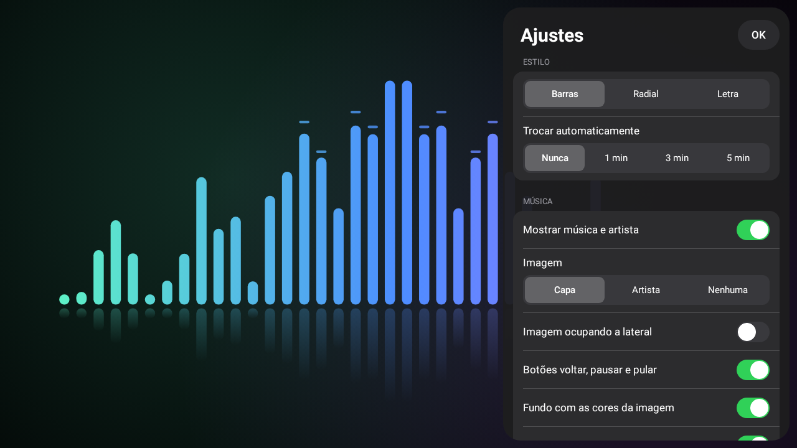

<div align="center">

# Pulse

**Visualizador de música para Android e Android Auto**

Barras que reagem ao som, letra sincronizada palavra por palavra e a capa do álbum,
no celular e na tela do carro.


</div>

---

## O que o Pulse faz

| | |
|---|---|
| 🎚️ **Visualizador** | Estilos **Barras** e **Radial**, com picos, reflexo, espelhamento e cores por frequência. Troque deslizando a tela. |
| 🎤 **Letra sincronizada** | Página **Letra** com destaque palavra por palavra quando a letra tem esse tempo, e ajuste fino da sincronia. |
| 🎵 **Música tocando** | Título, artista, capa ou foto do artista, fundo desfocado com as cores da imagem e botões voltar/pausar/pular. Funciona com Spotify, YouTube Music e qualquer player com sessão de mídia. |
| 🚗 **Android Auto** | A mesma interface na tela do carro, inclusive com o celular bloqueado. Com outro app aberto, vira um cartão compacto ao lado. |
| 📻 **Central sem internet** | Opcional: o Pulse do celular envia música, capa e letra por Bluetooth para o Pulse instalado numa central multimídia Android. |
| 🔒 **Privado** | Nada é gravado nem enviado para servidores próprios. Veja [Privacidade](#privacidade). |

### Letra sincronizada sílaba por sílaba

Quando o [LRCLIB](https://lrclib.net) tem o tempo de cada sílaba, o Pulse preenche a linha
cantada de branco, da esquerda para a direita, no ritmo da voz:

<div align="center">
  
  <br>
  
</div>

<sub>Nas imagens: "Amazing Grace" (John Newton, 1779) e "Hino à Alegria" (Beethoven), em domínio
público. As capas são ilustrações de teste.</sub>

### Telas

<table>
  <tr>
    <td></td>
    <td></td>
  </tr>
  <tr>
    <td align="center"><sub>Barras</sub></td>
    <td align="center"><sub>Radial</sub></td>
  </tr>
  <tr>
    <td></td>
    <td></td>
  </tr>
  <tr>
    <td align="center"><sub>Cartão ao lado de outro app no Android Auto</sub></td>
    <td align="center"><sub>Ajustes</sub></td>
  </tr>
</table>

## Instalação

1. Baixe o `Pulse.apk` mais recente em **[Releases](../../releases)** e instale no celular
   (o Android pede para permitir a instalação pelo navegador ou gerenciador de arquivos).
2. Abra o Pulse e permita o **microfone** (é assim que o Android libera a leitura do som que
   está tocando; nada é gravado).
3. Em **Ajustes → Música**, toque em **Permitir acesso às notificações** para o Pulse ler o
   título, o artista e a capa.

### No Android Auto

O Android Auto só mostra apps vindos da Play Store. Para o Pulse aparecer no carro:

1. No app **Android Auto** do celular, toque várias vezes em **Versão** até ligar o
   **modo desenvolvedor**; no menu **⋮ → Configurações do desenvolvedor**, ligue
   **Fontes desconhecidas**.
2. No Pulse, abra **Ajustes → Android Auto → Reinstalar para o Android Auto** e confirme.
   O Pulse se reinstala pelo instalador do Android informando a Play Store como origem
   (nada é baixado e os ajustes continuam). Repita depois de cada atualização.
3. Conecte ao carro: o Pulse aparece na lista de apps.

> [!NOTE]
> O Pulse se registra no Android Auto como app de navegação, a única categoria que pode
> desenhar livremente na tela do carro. Por isso ele não abre junto com Waze ou Google Maps.
> Esse caminho não é oficial: uma atualização do Android Auto pode mudar as regras.

## Privacidade

- O som é analisado só no aparelho, quadro a quadro, para desenhar o visualizador.
- O acesso às notificações serve apenas para ler a música que está tocando.
- Com a página Letra aberta, o título, o artista, o álbum e a duração vão para o
  [LRCLIB](https://lrclib.net), um banco de letras aberto.
- Com **Buscar imagens na internet** ligado, o artista e o título vão para a API pública da
  Deezer (foto do artista e capa em alta).
- Letras e imagens ficam num cache do app: letras até 10 MB, imagens só na memória.

## Compilar

Kotlin, Jetpack Compose e Android Car App Library. minSdk 24, targetSdk 35.

- **Windows:** `compilar.bat` compila numa cópia local (fora do Google Drive), roda os
  testes e o lint e gera `Pulse.apk` e as prévias de tela em `previas/`.
- **Android Studio:** abra a pasta do projeto normalmente.
- **Simulador do Android Auto:** `android-auto-720p.bat` abre o Desktop Head Unit em
  1280×720, ligado ao celular pelo cabo (no Android Auto do celular:
  **⋮ → Iniciar servidor da unidade principal**).

```
app/src/main/java/app/pulse/visualizer/
├── audio/      captura do som e espectro (FFT)
├── render/     estilos do visualizador
├── lyrics/     busca, leitura e cache das letras
├── media/      música tocando, capa e cores
├── car/        tela do Android Auto
├── link/       envio para a central multimídia por Bluetooth
└── ui/         telas em Compose
```

## Créditos

- Letras: [LRCLIB](https://lrclib.net).
- Parte da busca e da leitura de letras foi adaptada do projeto
  [auto-lyrics](https://github.com/GitUpGitUp/auto-lyrics) (MIT). Detalhes em
  [TERCEIROS.md](TERCEIROS.md).

## Licença

Pulse é software livre, distribuído sob a **GNU General Public License v3.0**: você pode usar,
estudar, modificar e redistribuir, desde que versões modificadas que forem distribuídas também
sejam publicadas sob a GPL-3.0, com o código-fonte. Texto completo em [LICENSE](LICENSE).

O código de terceiros mantém a própria licença (veja [TERCEIROS.md](TERCEIROS.md)).
