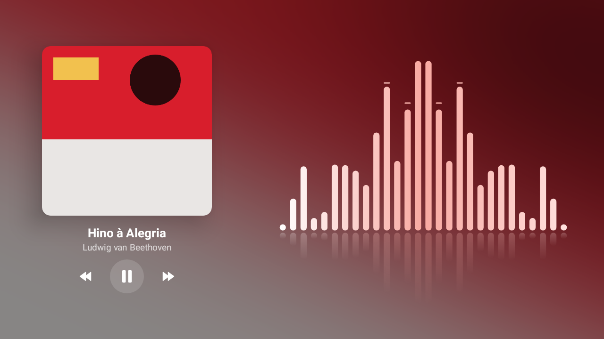
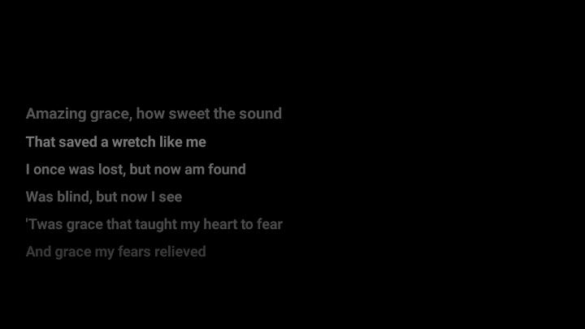
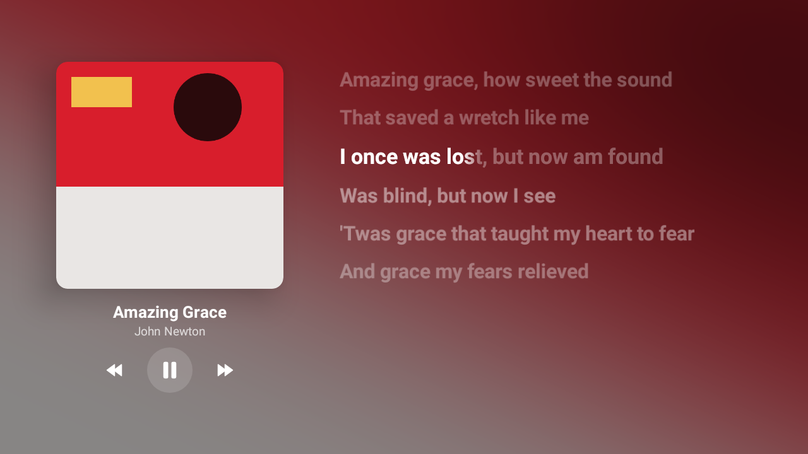

<div align="center">

**English** · [Português](README.pt-BR.md)

# Pulse

**Music visualizer for Android and Android Auto**

Bars that react to the sound, lyrics synced word by word and the album art,
on your phone and on your car's screen.




</div>

---

## What Pulse does

| | |
|---|---|
| 🎚️ **Visualizer** | **Bars** and **Radial** styles, with peaks, reflection, mirroring and colors by frequency. Swipe the screen to switch. |
| 🎤 **Synced lyrics** | A **Lyrics** page that highlights word by word when the lyrics carry that timing, with fine sync adjustment. |
| 🎵 **Now playing** | Title, artist, album art or artist photo, a blurred background in the image's colors and previous/pause/next buttons. Works with Spotify, YouTube Music and any player with a media session. |
| 🚗 **Android Auto** | The same interface on the car's screen, even with the phone locked. With another app open, it turns into a compact card on the side. |
| 📻 **Offline head unit** | Optional: Pulse on the phone sends the song, art and lyrics over Bluetooth to Pulse installed on an Android head unit. |
| 🔒 **Private** | Nothing is recorded or sent to servers of its own. See [Privacy](#privacy). |

### Lyrics synced syllable by syllable

When [LRCLIB](https://lrclib.net) has the timing of each syllable, Pulse fills the line being
sung in white, left to right, following the voice:

<div align="center">
  
  <br>
  
</div>

<sub>In the images: "Amazing Grace" (John Newton, 1779) and "Ode to Joy" (Beethoven), both in the
public domain. The album art is a test illustration.</sub>

### Screens

<table>
  <tr>
    <td></td>
    <td></td>
  </tr>
  <tr>
    <td align="center"><sub>Bars</sub></td>
    <td align="center"><sub>Radial</sub></td>
  </tr>
  <tr>
    <td></td>
    <td></td>
  </tr>
  <tr>
    <td align="center"><sub>Card next to another app in Android Auto</sub></td>
    <td align="center"><sub>Settings</sub></td>
  </tr>
</table>

<sub>The app's interface is in Brazilian Portuguese.</sub>

## Installation

1. Download the latest `Pulse.apk` from **[Releases](../../releases)** and install it on your phone
   (Android asks you to allow installing from your browser or file manager).
2. Open Pulse and allow the **microphone** (that's how Android lets an app read the sound being
   played; nothing is recorded).
3. In **Ajustes → Música** (Settings → Music), tap **Permitir acesso às notificações** (Allow
   notification access) so Pulse can read the title, artist and album art.

### On Android Auto

Android Auto only shows apps that come from the Play Store. To make Pulse show up in the car:

1. In the phone's **Android Auto** app, tap **Version** several times until **developer mode**
   turns on; in the **⋮ → Developer settings** menu, turn on **Unknown sources**.
2. In Pulse, open **Ajustes → Android Auto → Reinstalar para o Android Auto** (Reinstall for
   Android Auto) and confirm. Pulse reinstalls itself through Android's installer with the
   Play Store as its source (nothing is downloaded and your settings stay). Repeat after each
   update.
3. Connect to the car: Pulse shows up in the app list.

> [!NOTE]
> Pulse registers with Android Auto as a navigation app, the only category that can draw
> freely on the car's screen. That's why it doesn't open together with Waze or Google Maps.
> This path isn't official: an Android Auto update may change the rules.

## Privacy

- The sound is analyzed only on the device, frame by frame, to draw the visualizer.
- Notification access is used only to read the song that is playing.
- With the Lyrics page open, the title, artist, album and duration go to
  [LRCLIB](https://lrclib.net), an open lyrics database.
- With **Buscar imagens na internet** (Fetch images from the internet) on, the artist and title go
  to Deezer's public API (artist photo and high-resolution art).
- Lyrics and images stay in the app's cache: lyrics up to 10 MB, images only in memory.

## Building

Kotlin, Jetpack Compose and the Android Car App Library. minSdk 24, targetSdk 35.

- **Windows:** `compilar.bat` builds in a local copy (outside Google Drive), runs the tests and
  lint, and produces `Pulse.apk`, the screen previews in `previas/` and the lyrics GIF.
- **Android Studio:** open the project folder as usual.
- **Android Auto simulator:** `android-auto-720p.bat` opens the Desktop Head Unit at 1280×720,
  connected to the phone over USB (in the phone's Android Auto:
  **⋮ → Start head unit server**).

```
app/src/main/java/app/pulse/visualizer/
├── audio/      sound capture and spectrum (FFT)
├── render/     visualizer styles
├── lyrics/     fetching, parsing and caching lyrics
├── media/      now playing, album art and colors
├── car/        Android Auto screen
├── link/       Bluetooth link to the head unit
└── ui/         Compose screens
```

## Credits

- Lyrics: [LRCLIB](https://lrclib.net).
- Part of the lyrics fetching and parsing was adapted from the
  [auto-lyrics](https://github.com/GitUpGitUp/auto-lyrics) project (MIT). Details in
  [TERCEIROS.md](TERCEIROS.md).

## License

Pulse is free software, distributed under the **GNU General Public License v3.0**: you may use,
study, modify and redistribute it, as long as modified versions you distribute are also released
under the GPL-3.0, with their source code. Full text in [LICENSE](LICENSE).

Third-party code keeps its own license (see [TERCEIROS.md](TERCEIROS.md)).
